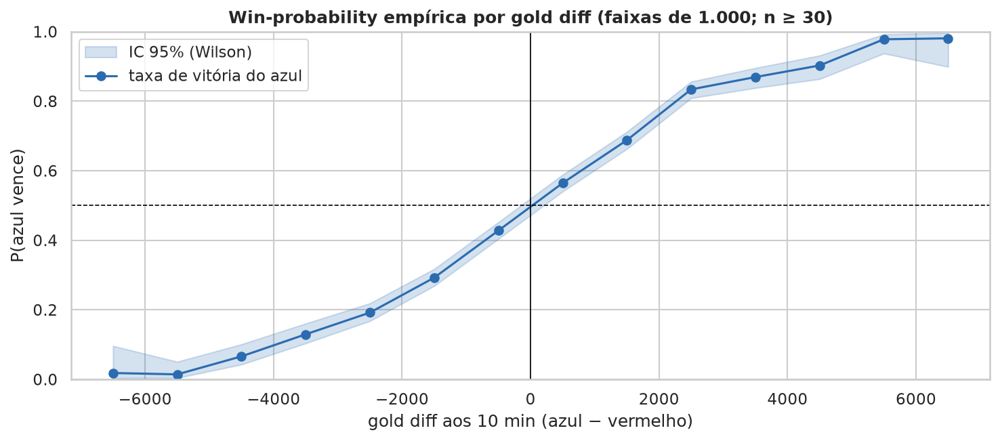
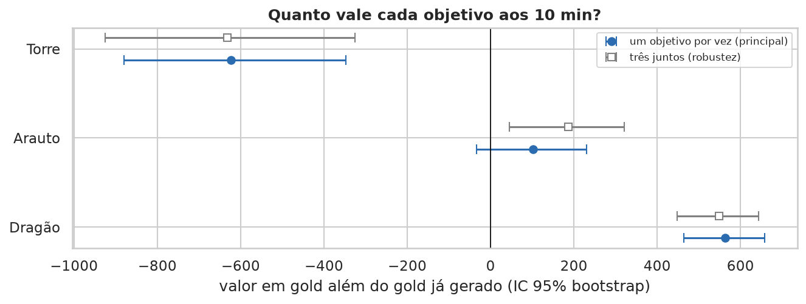
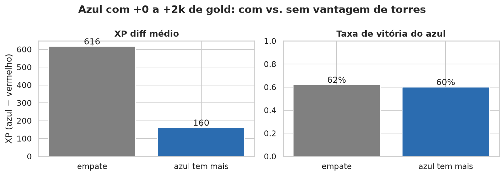
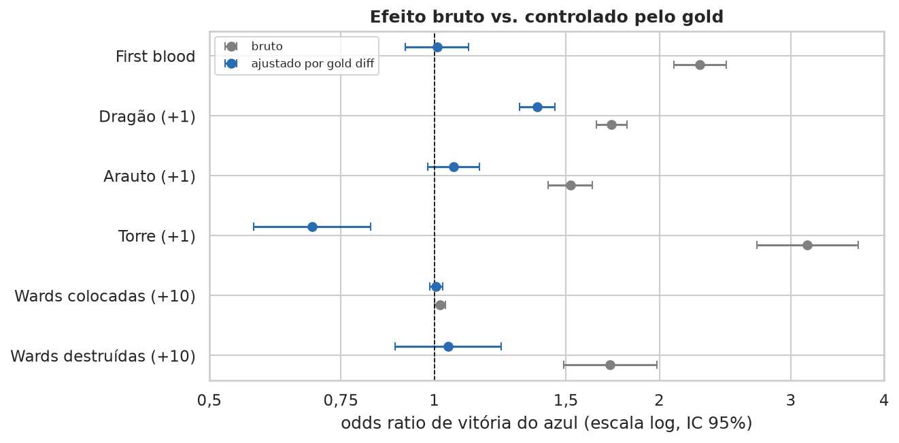
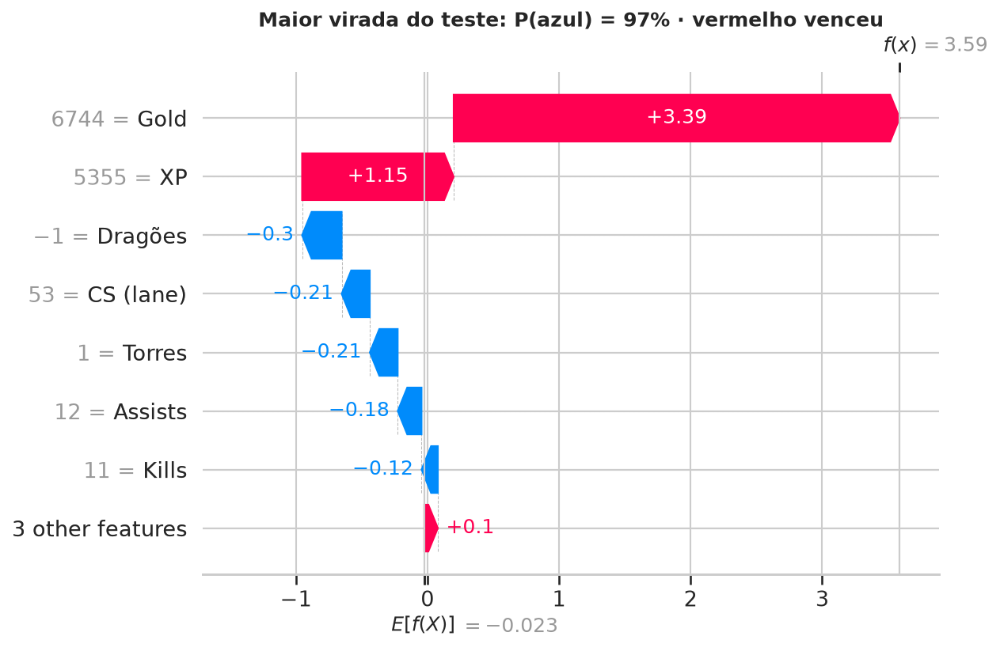
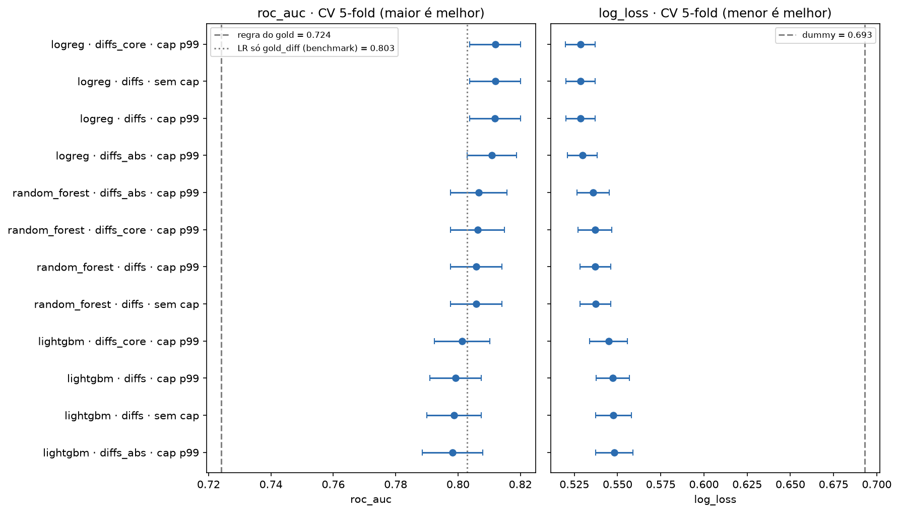
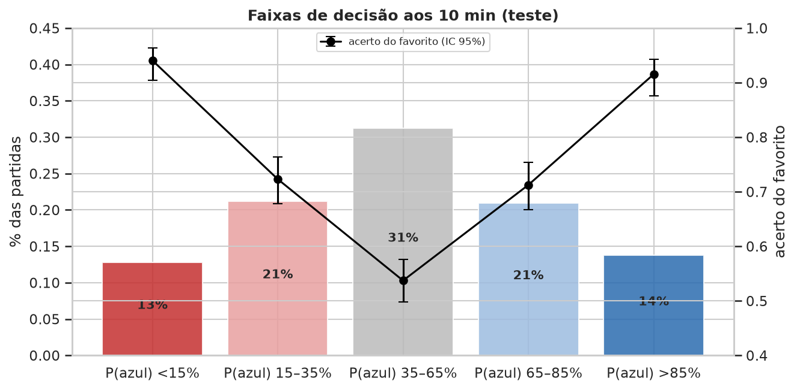
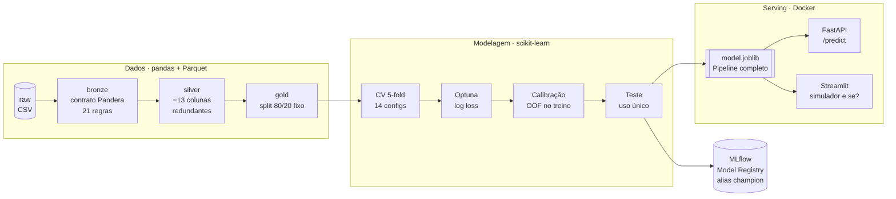

# ⚔️ LoL Win Predictor: quem vence, aos 10 minutos?

[](https://github.com/RToyoyama/lol-win-predictor/actions/workflows/ci.yml)


> **Aos 10 minutos de uma partida ranqueada de League of Legends, qual a probabilidade de o lado azul vencer?**

**Resultado em 3 linhas**
- Regressão logística com **ROC-AUC de 0,807** no teste e probabilidades **calibradas** (ECE de 0,03). Fica no teto realista para um snapshot aos 10 minutos.
- **Dá para cravar o vencedor em ~27% das partidas, com ~93% de acerto.** Em outros ~31% o jogo está genuinamente aberto: o favorito acerta só ~54%.
- **Quase tudo vira gold.** O dragão vale **~560 de gold** além do que mostra o placar. Gold vindo de torre vale *menos* do que gold vindo de luta e farm. First blood e wards não acrescentam nada depois que se controla pelo gold.

<sub>Projeto final da formação Cientista de Dados (EBAC). Stakeholder fictício: Tech Lead de dados da Riot Games.</sub>

---

## Sumário
[Problema](#-o-problema) · [Insights de jogo](#-o-que-os-dados-dizem-sobre-o-jogo) · [Modelo](#-o-modelo) · [Arquitetura](#-arquitetura) · [Como rodar](#-como-rodar) · [Decisões](#-decisões-e-trade-offs) · [Limitações](#-limitações) · [Produção](#-como-eu-monitoraria-em-produção) · [Próximos passos](#-próximos-passos) · [Estrutura](#-estrutura-do-repositório)

---

## 🎯 O problema

| | |
|---|---|
| **Dados** | 9.879 partidas ranqueadas de elo alto, **um snapshot aos 10 minutos** cada (gold, XP, kills, objetivos e visão dos dois times). Alvo: `blue_wins` |
| **O que não existe** | Dados de pré-jogo (composição, picks/bans, MMR) e de pós-10 minutos, que seriam vazamento |
| **Usos propostos** | **1.** barra de win-probability em transmissões · **2.** indicador de "jogo decidido" (contexto do surrender aos 15) · **3.** análise do equilíbrio de lados e do valor dos objetivos |

O produto é uma **probabilidade**, não um palpite binário. Isso guiou as escolhas de métrica, de objetivo do tuning (log loss) e de calibração.

---

## 🎮 O que os dados dizem sobre o jogo

Todos os testes estão no [Notebook 02](notebooks/02_hipoteses_de_jogo.ipynb). Cada um tem H0/H1, tamanho de efeito, IC e correção de Holm para múltiplos testes.

### 1. O gold diff é uma sigmoide quase perfeita


+1k de gold dá 57% de vitória, +2k dá 69%, +3k dá 83% e +5k dá 98%. Só a regra "quem tem mais gold vence" já acerta **72%**, e uma regressão logística só com gold diff chega a AUC 0,80. O resto das variáveis disputa o pouco que sobra.

### 2. Quanto vale cada objetivo, em gold, *além* do gold que ele já rendeu?


Método: num logit `vitória ~ gold_diff + objetivo`, a razão β<sub>objetivo</sub> / β<sub>gold</sub> é uma "taxa de câmbio" entre objetivo e gold, com IC por bootstrap (B = 1.000).

| Objetivo | Valor além do gold | Leitura de jogador |
|---|---|---|
| **Dragão** | **+563** [+464; +657] | Não dá gold direto, então o valor dele (buff, controle de rio) quase não aparece no placar de gold |
| Arauto | +102 [−34; +231] | Sem efeito próprio: o valor dele é virar torre e plates, e esse gold já está contado |
| **Torre** | **−624** [−881; −347] | O **paradoxo da torre** (abaixo) |

### 3. O paradoxo da torre


**Com o mesmo gold diff, quem tem vantagem de torre vence menos.** O motivo é que essa vantagem veio de uma "injeção" de gold da estrutura, **sem a XP e as kills** que acompanham uma vantagem construída em lutas e farm. Na mesma faixa de gold, o time com torre tem quase 4× menos vantagem de XP. *1.000 de gold vindo de torre valem menos que 1.000 vindo de kills.* Controlar por XP e kills explica parte do efeito, mas não todo.

### 4. First blood e visão: confusão em estado puro


| Variável | Odds ratio bruto | Controlando pelo gold |
|---|---|---|
| First blood | **2,27** | **1,01** [0,91; 1,11] |
| Wards destruídas (+10) | 1,72 | 1,04 [0,89; 1,23] |

Quem faz first blood ou limpa visão costuma ser quem já está na frente. Depois que o gold entra no modelo, **o efeito some**. *O first blood não decide o jogo: ele só entra na conta do gold.*

### 5. Lado azul × vermelho
Azul vence 49,9% (IC 48,9–50,9%, p = 0,86). **Não há vantagem de lado detectável.** O teste teria poder para enxergar desvios a partir de ±1,4 p.p.

### 6. As viradas não são um ponto cego do modelo


A maior virada do teste: **azul com +6,7k de gold e 97% de probabilidade, e o vermelho venceu.** Entre as partidas com favorito ≥ 80%, **11,6% viraram**, praticamente os 11,2% esperados para um modelo calibrado. Dentro da mesma faixa de confiança, as viradas não se distinguem em **nenhuma** variável disponível. Elas são o jogo acontecendo **depois** dos 10 minutos (teamfights, composição, macro). Prever melhor exige **outros dados**, não outro algoritmo.

---

## 📈 O modelo

**Escolhido:** regressão logística (elastic net) sobre 10 diferenças azul − vermelho (gold, XP, nível, kills, assists, dragões, arautos, torres, CS de lane e de jungle), **sem calibração extra**. Já sai calibrada.



Foram 14 configurações em CV 5-fold: 3 famílias (LR, Random Forest, LightGBM) × 3 conjuntos de features, mais uma ablação do cap de wards. Depois veio o tuning com Optuna (150 trials, minimizando log loss). **A LR venceu em todas as métricas e é a mais simples.** O melhor LightGBM usa `num_leaves = 4`, o que sinaliza que a relação é praticamente linear no logit.

### Teste (holdout de 1.976 partidas, usado uma única vez · IC 95% por bootstrap)

| Métrica | Modelo | CV no treino | Regra "mais gold vence" |
|---|---|---|---|
| **ROC-AUC** | **0,807** [0,789; 0,825] | 0,812 | 0,718 |
| Log loss | 0,531 [0,510; 0,551] | 0,528 | 10,16 |
| Brier | 0,180 [0,171; 0,188] | 0,177 | 0,282 |
| Acurácia | 71,7% [69,9; 73,6] | 73,7% | 71,8% |

> **Leitura honesta:** em acurácia, o modelo **empata** com a regra do gold. O valor dele está em dizer **quão decidida** está a partida: log loss de 0,53 contra 10,2, com calibração boa.

### Faixas de decisão (teste)


| P(azul) | % das partidas | Acerto do favorito |
|---|---|---|
| < 15% ou > 85% (**"decidido"**) | **26,6%** | **92,8%** |
| 15–35% ou 65–85% | 42,2% | ~72% |
| 35–65% (**"em aberto"**) | 31,3% | 53,7% |

**Recomendação para o indicador de "jogo decidido":** corte em **85%**, com o aviso "muito provável", nunca "acabou", porque cerca de 1 em cada 14 desses jogos vira.

📄 Detalhes completos no **[model card](reports/model_card.md)**.

---

## 🏗️ Arquitetura



**Regra anti training-serving skew:** o artefato é um `sklearn.Pipeline` que recebe as **estatísticas brutas** dos dois times e calcula as features por dentro: `WardsClipper` (teto p99 comum aos dois lados, aprendido só no `fit`) → `FeatureBuilder` → `StandardScaler` → modelo. API e app chamam só `predict_proba(stats_brutas)`, com o mesmo código do treino. O payload da API é convertido por uma única função (`to_input_frame`), que o app também usa.

**Qualidade:**
- 132 testes (contratos de dados, simetria das features, aditividade do SHAP, regras da API, app via `AppTest`);
- lint e format com ruff;
- pre-commit;
- CI com 3 jobs: testes, smoke test do pipeline de modelagem e build + smoke test da imagem Docker.

---

## 🚀 Como rodar

### Opção 1: só Docker (um comando)
```bash
git clone https://github.com/RToyoyama/lol-win-predictor.git && cd lol-win-predictor
docker compose up --build
```
- **App (simulador):** http://localhost:8501
- **API (Swagger):** http://localhost:8000/docs

O build roda o pipeline de dados e **reconstrói o modelo campeão** a partir da configuração versionada (`reports/metrics/*.json`), de forma determinística. Não depende de nenhum artefato fora do git.

### Opção 2: ambiente de desenvolvimento
Pré-requisitos: [uv](https://docs.astral.sh/uv/) e `make`.
```bash
make setup      # dependências (uv.lock) + hooks do pre-commit
make pipeline   # dados → CV (14 configs) → tuning (150 trials) → avaliação final (~5 min)
make app        # simulador em http://localhost:8501
make api        # API em http://localhost:8000/docs
make test       # 132 testes
make mlflow-ui  # experimentos no MLflow
```

### Exemplo de chamada à API
```bash
curl -X POST localhost:8000/predict -H 'content-type: application/json' -d '{
  "blue": {"kills": 7, "assists": 9, "dragons": 1, "heralds": 0, "towers_destroyed": 0,
           "total_gold": 17200, "total_experience": 18100, "avg_level": 7.0,
           "total_minions_killed": 220, "total_jungle_minions_killed": 52,
           "wards_placed": 18, "wards_destroyed": 3},
  "red":  {"kills": 4, "assists": 5, "dragons": 0, "heralds": 1, "towers_destroyed": 0,
           "total_gold": 15600, "total_experience": 17400, "avg_level": 6.8,
           "total_minions_killed": 212, "total_jungle_minions_killed": 49,
           "wards_placed": 15, "wards_destroyed": 2},
  "first_blood": "blue"
}'
# {"p_blue_win":0.7589,"p_red_win":0.2411,"favorite":"blue",
#  "faixa":{"label":"65–85%","description":"azul favorito"},"model_version":"lol-win-predictor:v1"}
```
A validação aplica as regras do jogo: 2 dragões somados aos 10 minutos ou um time de first blood sem kill retornam **422** com a mensagem do erro.

---

## ⚖️ Decisões e trade-offs

| Decisão | Por quê | Custo |
|---|---|---|
| **Pipeline sobre stats brutas** (features calculadas dentro do modelo) | Elimina o *training-serving skew*. O cap de wards precisa ser no valor absoluto, ajustado só no treino | A camada gold não materializa as features |
| **Log loss como objetivo do tuning**, AUC como métrica principal | O produto é uma barra de probabilidade, e o log loss premia calibração. A AUC só mede ordenação | — |
| **Regressão logística** em vez de LightGBM | Melhor em todas as métricas, sem overfitting (gap de 0,001), interpretável e já calibrada | — |
| **`diffs_core`** (sem wards e first blood) | Sem efeito além do gold na inferência (Notebook 02) **e** na previsão (CV) | API e app ainda recebem esses campos, para manter o contrato estável |
| **Cap p99 em wards** | Cauda multimodal de provável artefato de coleta (até 276 wards em 10 minutos) | Na prática, efeito nulo na CV; mantido por robustez |
| **Holdout usado uma vez** + escolhas só por CV e predições out-of-fold | Estimativa de teste honesta | Um split só: a acurácia variou 2 p.p. entre CV e teste |
| **MLflow com SQLite** | O backend em arquivo dá erro no MLflow 3 | — |
| **Imagem Docker única** (API + app) | Simplicidade: um build, dois `command` | 1,65 GB. Duas imagens deixariam a API com ~600 MB |
| Inferência com **todas** as partidas (Notebook 02) | É inferência, não seleção de modelo: nenhum número de lá vira parâmetro do modelo | Exige disciplina: a seleção de features foi feita só por CV |

---

## ⚠️ Limitações

- **Snapshot único aos 10 minutos:** não há composição, picks/bans, MMR nem estado minuto a minuto. O teto prático é de AUC ≈ 0,81–0,82.
- **Elo alto, com patch e região desconhecidos:** não dá para garantir a transferência para outros elos ou patches.
- **Colinearidade:** gold, XP, kills e nível têm VIF de até 23. Coeficientes e SHAP individuais desse bloco não devem ser lidos isoladamente.
- **Associação, não causa:** o "valor em gold" dos objetivos é controlado pelo gold, mas continua sendo observacional.
- **API de demonstração:** sem autenticação nem rate limit.

---

## 🔭 Como eu monitoraria em produção

| O que monitorar | Como | Gatilho de ação |
|---|---|---|
| Drift de entrada | PSI das diffs de gold, XP e dragões, por patch | PSI > 0,2 |
| Calibração | ECE e curva de calibração semanais, com resultados reais | ECE > 0,05 |
| Discriminação | AUC móvel em janela de 1–2 semanas | Queda > 0,02 vs. 0,807 |
| Mudança de patch | Reestimar o valor do dragão e retreinar | Patch com mudança em objetivos ou gold |
| Serviço | Latência p95 e taxa de 4xx/5xx da API | 5xx > 1% |

O Model Registry (alias `champion`) permite trocar de modelo sem mudar o código. O `export` reconstrói o artefato a partir da configuração versionada.

---

## 🧭 Próximos passos

1. **Riot API (Match-V5 timeline):** coletar dados por minuto, com patch e elo, e acompanhar a probabilidade **ao longo do jogo**, não só aos 10 minutos.
2. **Modelo de pré-jogo por composição:** picks/bans e sinergias. Isso ataca justamente as viradas, que hoje o dado não explica.
3. **Dragões por tipo e almas, barão, plates por lane:** separar a origem do gold, aprofundando o paradoxo da torre.
4. **Produção:** autenticação e rate limit na API, imagens separadas para API e app, monitoramento automatizado (tabela acima).

---

## 📁 Estrutura do repositório

```
├── data/raw/                      # CSV original (versionado); bronze/silver/gold são gerados
├── notebooks/
│   ├── 01_eda.ipynb               # EDA → decisões de features
│   ├── 02_hipoteses_de_jogo.ipynb # 4 hipóteses com H0/H1, efeito, IC e Holm
│   └── 03_interpretacao_e_decisao.ipynb  # SHAP, viradas, faixas de decisão
├── src/lol_win/
│   ├── data/        # ingestão, contratos Pandera, limpeza, split
│   ├── features/    # build_features + transformers do Pipeline
│   ├── models/      # baselines, registry, train (CV+MLflow), tune, calibrate, final, export, predict
│   ├── analysis/    # funções de EDA, inferência e interpretação usadas pelos notebooks
│   ├── api/         # FastAPI + schemas Pydantic
│   └── app/         # Streamlit (logic.py testável + UI)
├── reports/
│   ├── figures/     # todas as figuras dos notebooks e do pipeline
│   ├── metrics/     # cv_comparison, tuning_results, calibration, final.json, decision_bands
│   └── model_card.md
├── docs/            # glossário e roteiro do vídeo
├── tests/           # 132 testes
├── Dockerfile · docker-compose.yml · Makefile · pyproject.toml · uv.lock
└── .github/workflows/ci.yml
```

📚 Termos técnicos explicados no **[glossário](docs/glossario.md)**.

**Stack:** Python 3.11 · uv · pandas · Pandera · scikit-learn · LightGBM · Optuna · MLflow · statsmodels · SHAP · FastAPI · Pydantic · Streamlit · pytest · ruff · Docker · GitHub Actions
